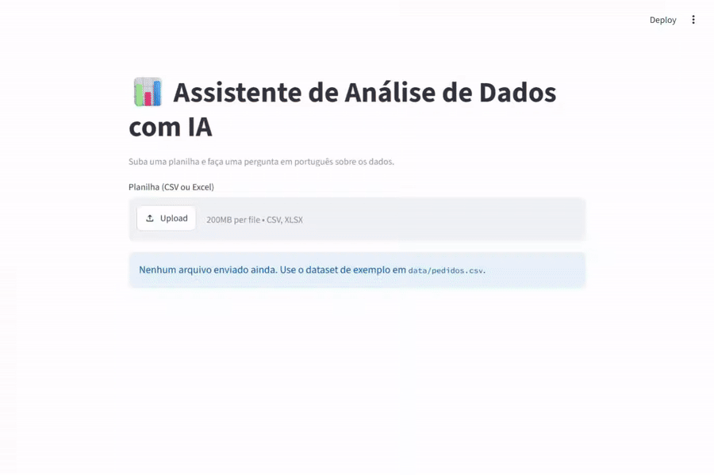
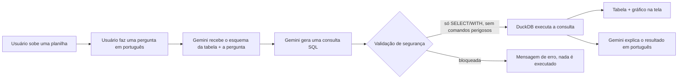

# 📊 Assistente de Análise de Dados com IA

Um app web onde você sobe uma planilha, faz uma pergunta em português e recebe
a resposta em texto, tabela e gráfico — sem precisar escrever SQL.

Projeto de portfólio feito por **Olavo de Oliveira Alvarez** para a candidatura
ao Programa de Estágio GenAI do iFood (trilha AI Engineer).

## 🔗 Demonstração

**App publicado:** _(link será adicionado após a publicação no Streamlit Community Cloud)_



## O problema que o projeto resolve

Times de negócio costumam ter perguntas simples sobre os dados ("qual
categoria vendeu mais em março?") mas nem sempre têm alguém disponível pra
escrever a consulta SQL na hora. Este app deixa qualquer pessoa perguntar em
português e receber a resposta na hora, sem depender de um analista pra cada
pergunta pontual — mantendo a transparência de mostrar a consulta gerada.

**Para quem é:** qualquer pessoa que tenha uma planilha e precise de respostas
rápidas sobre ela, sem saber SQL.

## Como funciona



1. O app lê a planilha e extrai o esquema: nomes de colunas, tipos, e (para
   colunas de texto com poucos valores distintos) os valores possíveis.
2. Envia esse esquema + a pergunta do usuário para o Gemini, pedindo **apenas
   uma consulta SQL de leitura** (dialeto DuckDB).
3. A consulta é validada antes de rodar: só aceita `SELECT`/`WITH`; bloqueia
   qualquer comando que altere dados, acesse arquivos ou mude configuração do
   banco (`INSERT`, `DELETE`, `DROP`, `ATTACH`, `COPY`, `PRAGMA`, etc). **O
   código Python gerado por IA nunca é executado — só SQL validado.**
4. A consulta roda no DuckDB sobre a planilha carregada (em memória).
5. O Gemini recebe o resultado e escreve uma frase curta explicando a
   resposta em português.
6. A consulta SQL gerada fica visível numa área expansível ("Ver SQL
   gerado"), por transparência.

## Prompts usados e decisões de prompt engineering

Os prompts ficam isolados em [`prompts.py`](prompts.py), separados da lógica
do app. Duas chamadas distintas ao modelo, cada uma com uma única
responsabilidade:

**1. Pergunta → SQL** (`PROMPT_SQL`): recebe o esquema da tabela (incluindo
valores possíveis das colunas de texto, pra evitar que o modelo "invente"
um valor que não existe nos dados) e pede *apenas* a consulta SQL, sem
explicação. Instrui o modelo a responder `ERRO: <motivo>` quando a pergunta
não puder ser respondida com os dados disponíveis — isso evita que ele tente
"forçar" uma resposta errada para perguntas ambíguas ou fora do escopo.

**2. Resultado → explicação** (`PROMPT_EXPLICACAO`): recebe a pergunta
original, a consulta executada e as primeiras linhas do resultado, e pede uma
explicação curta em português. Separar essa etapa da geração do SQL mantém
cada chamada simples e fácil de debugar.

Essas decisões vieram de testes reais — ver a seção de limitações abaixo e o
script [`testar_perguntas.py`](testar_perguntas.py), usado para testar 12
perguntas diferentes durante o desenvolvimento.

## Segurança

- A chave da API fica **somente** em variável de ambiente (`.env` local,
  Secrets no Streamlit Cloud) — nunca no código.
- Toda consulta SQL gerada passa pela validação em
  [`seguranca.py`](seguranca.py) antes de ser executada.
- Nenhum código Python gerado pela IA é executado — só a consulta SQL, e só
  depois de validada.
- O DuckDB roda em memória, sobre a planilha que o próprio usuário subiu —
  não há acesso a arquivos do servidor nem a outros bancos de dados.

## Como rodar localmente

```bash
git clone https://github.com/Olavo07/ifood-genai-assistente-dados.git
cd ifood-genai-assistente-dados

python -m venv venv
venv\Scripts\activate        # Windows
# source venv/bin/activate   # Linux/Mac

pip install -r requirements.txt

# Copie .env.example para .env e preencha com sua própria chave gratuita
# gerada em https://aistudio.google.com/apikey
cp .env.example .env

streamlit run app.py
```

Não tem uma planilha à mão? Gere o dataset sintético de exemplo com:

```bash
python gerar_dataset.py
```

Isso cria `data/pedidos.csv` (pedidos de delivery fictícios — sem dados reais
de nenhuma empresa).

## Limitações (honestas)

- O modelo às vezes recusa perguntas que exigiriam análise estatística (ex:
  correlação) porque instruí-lo a só gerar SQL simples de agregação —
  decisão consciente de manter o escopo controlado, não uma limitação do
  modelo em si.
- A validação de segurança bloqueia comandos por palavra-chave. Não é uma
  sandbox de banco de dados completa — funciona bem para o escopo deste
  projeto (planilha que o próprio usuário sobe, sem dados sensíveis), mas eu
  não usaria essa abordagem sozinha num sistema com dados de produção.
- O esquema da tabela (incluindo valores únicos de colunas de texto) é
  enviado por inteiro em todo prompt — funciona bem para planilhas pequenas/
  médias, mas não escala para tabelas com centenas de colunas ou colunas de
  texto com alta cardinalidade.
- Cada pergunta é independente — o app não tem memória de perguntas
  anteriores na mesma sessão.
- O dataset de exemplo é sintético (gerado por script), sem relação com
  dados reais do iFood ou de qualquer empresa.

## Próximos passos

- Notebook de Machine Learning simples (ex: Titanic no Kaggle), documentando
  cada etapa.
- Memória de conversa (permitir perguntas de acompanhamento, ex: "e por
  bairro?").
- Suporte a mais de uma planilha / mais de uma tabela.

## Tecnologias usadas

- **Python** + **Streamlit** — interface web
- **pandas** — leitura e preparo dos dados
- **DuckDB** — execução das consultas SQL em memória
- **Google Gemini API** (`google-genai`) — geração de SQL e explicação em
  linguagem natural
- **python-dotenv** — variáveis de ambiente
- Publicado no **Streamlit Community Cloud**
